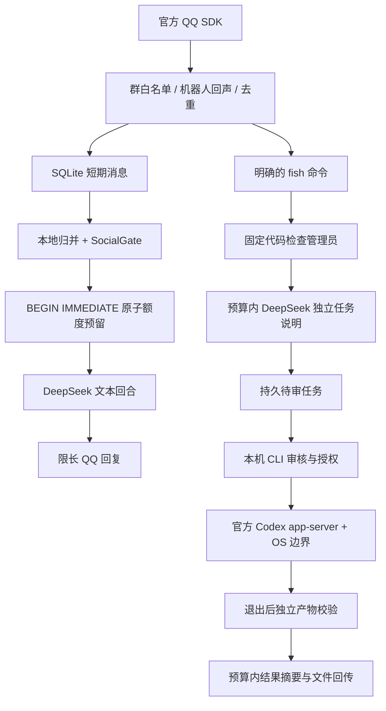

# 实现架构

应用是一个受限调度适配层，复用腾讯官方 QQ SDK/扫码 connector 和官方 Codex app-server。没有重写 QQ 协议或 Codex Agent Runtime，也没有启动有通用工具权限的群聊 Agent。

`Bot` 只允许程序识别的明确命令进入搜索、图片或任务流程。普通模型回合不暴露工具，因此即使输出命令或权限 JSON 也只有文字效果。管理员身份来自事件的 member_openid 与本地白名单，模型没有增改白名单的接口。

每群固定 1.2 秒窗口归并，队列每群最多 20 个工作项；不会靠不断重置 debounce 拖延繁忙群的处理。普通消息默认只缓存。SocialGate 检查新消息是否 @/呼唤，再考虑自动回复或自主插话。自主插话参考最近 90 秒窗口，要求同话题至少两条、最后消息仍活跃；兴趣词用于轻量主题分类。这不是高精度语义话题识别。

SQLite 使用 WAL、busy_timeout、BEGIN IMMEDIATE。调用前先记录 reservation 和 counters。文本模型预留序列化 UTF-8 字节数加 4096 framing 余量及最大输出 token，调用结束使用实际 usage 结算；不确定的错误和崩溃保留预留费用，不自动退款。如果服务端 usage 超出保守上界，会记录实际数并锁住后续请求，需要本机检查。该防御依赖 DeepSeek 文本 BPE 与没有隐藏工具上下文的调用协议，不是提供商收费的数学证明。

每日使用北京时间自然日；reservation 记录自己的日期，跨午夜仍在原日结算。全局 token、每群 token、每用户模型调用次数独立计数。搜索不占文本模型 token，但有预留请求数。Codex 使用任务数、最坏执行时长预留和全局并发 1，不制造订阅 token 数字。图片也有单独计数。

任务状态：waiting → running → succeeded / failed / cancelled / timed_out。群命令只能创建 waiting；本地 API 认证且明确 reviewed 后才能运行。关闭/崩溃不自动重放任务。超时与取消先终止实际进程，再允许收集产物；中断任务没有成功产物。

搜索只发往固定 DeepSeek HTTPS API；不会访问或执行来源网页。固定 query 长度、count、超时、1 MiB 响应上限、10 分钟缓存和去重并发请求控制成本。来源 URL 由代码附加，不依赖模型记住引用。

状态服务只监听 127.0.0.1；管理令牌留在项目 runtime，浏览器页面不内嵌令牌。仅一个常驻实例可占用配置端口；Mock/Demo/Live 使用独立账本。
