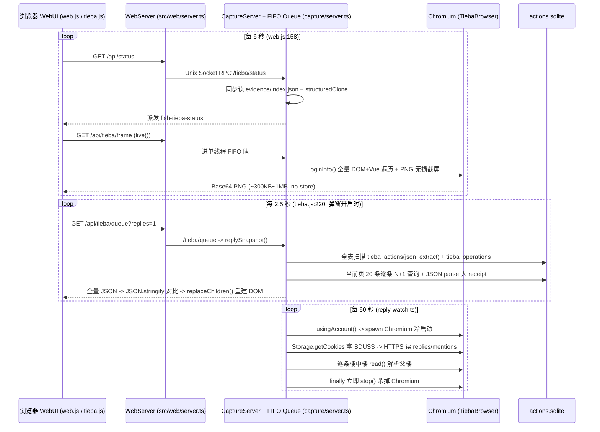

# P0 / P1 详细评价、现状通路与改造方案

本文档针对当前代码库中两类最影响体验的问题给出代码级评价、端到端通路梳理与可执行改造方案：

- **P0**：贴吧反馈 Web 界面与队列通道卡顿、资源抖动及配套边界 Bug。
- **P1**：DeepSeek（非思考模式 `deepseek-flash`）日常与自主探索活动质量异常、上下文缓存失效、规则误杀及工具协议（MCP 思维）层面的混乱。

> 编写前提：**现有贴吧发送机制与 QQ 对话/媒体/权限的核心业务逻辑已经过验证并获得认可**。所有 P0 / P1 改造均以**不破坏既有安全契约与业务语义**为红线。

---

## 一、不可破坏的既有契约（Invariants）

以下行为来自代码与 [项目约定与运行说明](project-conventions.md)，改造期间必须完整保留：

1. **贴吧发送与账号隔离契约**
   - 贴吧新主题走官网原生发布器（`/c/c/thread/add_pc`）；模型回帖统一通过 `publish_tieba`（`action=reply` + `target=replyTarget`）。
   - 保留 `WebPostGate` 提交前防篡改与防重发、`tieba_actions` 持久化 Outbox 幂等、关注吧白名单、大肥鱼吧分区校验、真实平台回执与公开可读性回查、人工验证码接管流程。
   - 严禁向模型或后台开放删帖、禁言、封禁等吧务写操作；严禁新增行为锁、跨请求失败锁或待验证锁。
   - Cookie / Profile 仍仅留在隔离的 `deepseekfish-capture` 进程内，绝不暴露给 WebUI、日志或模型上下文。
2. **QQ 对话与媒体隔离契约**
   - 保留 NapCat / OneBot 接入、私聊直回、群聊 `@`/关键词唤醒策略（普通群消息仅归档不调模型）。
   - 保留 6 条消息 / 1500 token 的近聊默认窗口、24 轮 / 64 次工具额度及第 21 轮柔性提示、发送者昵称/群名片与收件人保留、媒体隔离解码与动图原字节保留、生图 broker 隔离与日张数限额、共享人民币预算与原子预留。
3. **人格与模型自由选择契约**
   - 肥鱼的人格 prompt（含颜文字抽样）**必须保留在模型请求的最后一条**。
   - **不使用关键词意图路由强行门控工具或替模型决策**；保留 5000-token 自主知识库与 `reply.memory` 同轮保存；保留 `search_web` 与 `fetch_page`/`browse_page` 在开启联网时的可用性。
   - 外部发送仍需拦截可能泄漏的真实 QQ 号，内部咨询允许引用原始数字。

---

## 二、P0：贴吧反馈 Web 界面卡顿——详细评价与通路

### 2.1 现有端到端通路（为什么会卡）

### 2.2 代码级根因评价

| 编号 | 痛点现象 | 精确源码位置 | 根因说明 |
| --- | --- | --- | --- |
| P0-1 | 弹窗操作卡顿、刷新排队动辄几十秒 | `src/tieba/session.ts:147-155` `src/tieba/reply-watch.ts:26-60` `src/capture/tieba-browser.ts:478-521` | `usingAccount()` 和 `read()` 每次结束后都在 `finally` 里 `await this.stop()` **直接杀掉 Chromium**。而 `replies`/`mentions`/`followed`/`read` 实际走的都是直连 HTTPS（只为拿 `BDUSS` 才起浏览器），导致后台 `TiebaReplyWatch` 每分钟冷启动+杀掉一次 Chromium，并独占 `TiebaOperationQueue` 单线程 FIFO 队列；扫 `replies` 时还会对每条楼中楼逐个 `browser.read()`，直接堵死人工操作。 |
| P0-2 | 贴吧队列列表越用越卡、详情展开老被重置 | `src/web/public/tieba.js:174-220` `src/tieba/queue.ts:136-175` | 前端每 2.5s 轮询 `/api/tieba/queue?replies=1`；后端 `replySnapshot()` 每次都对 `tieba_actions` 做**无索引的 `json_extract(request,'$.action')` 全表扫描** + 全表扫 `tieba_operations`，在 JS 内存排序后再对 20 条记录做 40+ 次 N+1 查询与大 JSON 反序列化；前端拿到后全量 `JSON.stringify` 对比，稍有字段变动即 `replaceChildren()` 整块销毁 DOM。 |
| P0-3 | 官网交互画面拖拽/点击极慢、带宽和主线程压力大 | `src/web/public/web.js:158` `src/web/public/tieba.js:281-295,373-388` `src/capture/tieba-browser.ts:154,461` | `/api/status` 每 6s 联动触发 `live()` 拉帧；`frame()` 走单线程 FIFO 队、先跑一大段含 Vue `__vue__` 遍历的 `loginInfo()`、写 `status.json`，再 `Page.captureScreenshot({format:'png'})` 输出 1000×800 无损 PNG 转 base64 经 socket 中转，无哈希去重、无缓存；`web.css` 中 `dialog::backdrop { backdrop-filter: blur(4px) }` 也在大弹窗滚动时拖慢合成帧率。 |
| P0-4 | 历史发言接口重、反复开关 SQLite | `src/tieba/posting.ts:264-276` `src/web/public/tieba.js:344-361` | `tiebaHistoryPage()` 每次请求新建并关闭 `DatabaseSync`，且返回整条包含递归 `initialResult`、`receipt`、`checks`、`evidence` 的大对象并在前端渲染全量 `<pre>`。 |
| P0-5 | RPC 超时与队列上限打架，误报 `TIEBA_WORKER_UNAVAILABLE` | `src/tieba/client.ts:18` `src/tieba/queue.ts:13-21` `src/capture/server.ts:153` | 队列允许 `publish`/`publication-submit` 最长跑 240s、`publication-start` 120s，但 `tiebaRpc` 客户端超时写死 **90s**，`capture/server.ts` 的 `server.requestTimeout` 写死 **30s**。长操作正常等待时客户端会提前断开。 |
| P0-6 | Tailscale 访问活动页每 3s 静默 403 | `src/web/tailnet.ts:3-4` `src/web/public/activity.js:245,261` | `tailnet.ts` 白名单漏掉了 `GET /api/activity/active` 和 `POST /api/activity/interrupt`。 |

### 2.3 P0 改造目标通路与实施方案

1. **Chromium 空闲保活复用 + 后台巡检避让人工交互**
   - `TiebaSessionManager`（`src/tieba/session.ts`）：在 `usingAccount()` 与 `read()` 的 `finally` 中，正常结束时改为 `this.touch()`（复用已有 `idleMs = 5 * 60000` 空闲回收），不再每次用完立即 `stop()` 杀进程；出错需要重置、显式 `close()`/`logout()` 或超时清理时仍立即 `stop()`。
   - 在 `TiebaSessionManager` / `TiebaBrowser` 进程内部：对只读操作（`read`/`replies`/`mentions`/`account`）在短时间窗（如 30~60s）内复用最近验证过的身份状态，**写操作（`publish`/`moderator`/`publication-*`）前仍强制实时 `identity()` 校验**，保证权限边界零妥协。
   - `TiebaReplyWatch`（`src/tieba/reply-watch.ts`）：如果 `status.interaction` 非空（人工正在登录/过验证码/提交回复）或队列 `workerBusy` 为真，本轮直接跳过并顺延 15~30s，不与人工交互争抢 FIFO 队列；对 `replies()` 里的楼中楼父楼解析增加 `(threadId, referencePostId)` 内存/SQLite 缓存，避免每分钟重复 `read()` 同一旧通知。
2. **队列查询索引化、摘要/详情分离与 Revision 增量刷新**
   - `TiebaOperationQueue`（`src/tieba/queue.ts`）：
     - 在 `tieba_operations` 与 `tieba_actions` 上维护索引列（`request_id`、`action_kind`，对历史行一次性回填迁移），消除 `replySnapshot()` 的全表 `json_extract` 扫描与 N+1 查询（改为索引分页 + 批量 `IN (...)` 读取）。
     - 维护单调递增的内存 `revision`（每次入队、状态流转、写回执、验证完成时 `revision++`）。`/api/tieba/queue` 支持可选参数 `sinceRevision`：若列表和选中项均无变化，直接返回 `{ unchanged: true, revision, workerBusy }`。
     - 列表数组 `active`/`completed` 仅携带卡片渲染所需的轻量摘要（`id`、`state`、`createdAt`、`startedAt`、`finishedAt`、`metadata` 中的预览字段、`result` 的 `outcome`/`visibility`/`error`/`verifiedAt`/`submitted`/`publicVerified` 等），**完整 `receipt`、`steps`、`checks`、`evidence` 仅在 `selected`（对应 `selectedId`）中返回**，大幅压缩响应体积。
   - 前端 `src/web/public/tieba.js`：
     - 携带 `sinceRevision`，收到 `unchanged: true` 时跳过对比和重绘。
     - 轮询自适应：有 `active` 任务或 `workerBusy` 时每 2.5~3s 刷新，全部空闲时自动退避至 10~15s；任何按钮点击/验证/状态变更后立即触发一次刷新。
     - `renderQueueDetail` 中若用户已展开 `
`（如诊断/截图/步骤）且该条目内容未变，禁止重建该 DOM 节点；`tieba-queue-list` 列表节点优先按 `replyId` 原地更新而非整块清空重排。
3. **截屏链路减重与解耦**
   - `TiebaBrowser.frame()`（`src/capture/tieba-browser.ts`）：支持 `format: 'jpeg', quality: 75`（默认用于交互实时预览，证据存档 `captureEvidence` 保持原样或可配置），同时返回真实 `mime`（`image/jpeg` 或 `image/png`），Web 接口按真实 `mime` 设置 `Content-Type`。
   - `TiebaSessionManager.frame()`（`src/tieba/session.ts`）：实时取帧路径不再每次跑沉重的全量 `loginInfo()` + 同步写盘 `status.json`（只取轻量页面标题/挑战标志，或把完整 `loginInfo()` 留在 `start`/`prepare_failed`/显式状态刷新时执行）。
   - 为 `/api/tieba/frame` 和 `/api/tieba/publication-frame` 增加基于画面 SHA-256 的 `ETag` / `If-None-Match`（或前端传 `lastHash`），画面未变化时返回 `304`，避免每 6 秒重复下载和解码相同图片。
   - `/api/status` 轮询不再无条件触发 `live()` 拉帧；仅在弹窗打开、页面可见且处于交互态时由独立可控定时器（例如 3~4s）或在 `input()` 完成后拉取新帧。
   - `src/web/public/web.css`：取消大弹窗下的 `dialog::backdrop { backdrop-filter: blur(4px) }`（保留半透明遮罩色），降低移动端和低配设备滚动合成开销。
4. **修复超时错配、历史库复用与 Tailnet 白名单**
   - `src/tieba/client.ts`：按 `action` 对齐超时上限（`publish`/`publication-submit`: 300s，`moderator`: 240s，`start`/`publication-start`: 180s，`input`: 270s，其余读操作: 120s，`status`: 5s）。
   - `src/capture/server.ts`：将 `server.requestTimeout` 设为 `0`（仅保留 `headersTimeout = 5000`），避免 HTTP 层 30s 提前掐断合法的队列长任务（实际超时由 `TiebaOperationQueue.executionLimit` 精确控制）。
   - `src/web/tailnet.ts`：在 `reads` 中补齐 `/api/activity/active`，在 `writes` 中补齐 `/api/activity/interrupt`。
   - `src/tieba/posting.ts`：`tiebaHistoryPage` 复用长连接只读库句柄或避免在 `result` 中无限嵌套 `initialResult`（写入 `initialResult` 时剥离其内部重复的 `initialResult`）。

---

## 三、P1：DeepSeek 活动质量与工具协议——详细评价与通路

### 3.1 现有模型调用与工具调度通路

```mermaid
flowchart TD
    A[4 套各自手写的 Agent Loop] --> A1[QQ 对话: src/agent/bot.ts<br/>36~37 工具 / 24轮]
    A --> A2[自主探索: src/exploration/worker.ts<br/>38~39 工具 / 无轮次上限]
    A --> A3[任务链: src/qq/activity-chain.ts<br/>39~40 工具 / 24轮]
    A --> A4[Web 聊天: src/web/app.ts<br/>8 工具 / 5轮]

    A1 & A2 & A3 --> B[每轮构造 messages]
    B --> B1[原地改写 messages&#91;0&#93;/&#91;1&#93;<br/>+ TurnContext.compact 原地改写历史 tool 消息]
    B1 --> B2[KV Cache 前缀每轮失效<br/>延迟升高 + 费用飙升]

    A1 & A2 & A3 --> C[PromptNumberGuard]
    C --> C1[拉黑整个 messages 中所有 &ge;5 位数字]
    C1 --> C2[公开帖子 ID / B站 UID / 版本号 / 金额<br/>频繁触发 PROMPT_NUMBER_BLOCKED]

    A2 --> D[自主探索 textOnly == 3]
    D --> D1[强行 requireTool=true 且禁用 finish_exploration]
    D1 --> D2[模型想休息却被逼瞎调工具<br/>或 EXPLORATION_DECISION_STALLED]

    A1 & A2 --> E[UnreadFeedback]
    E --> E1[把旧对话/旧探索失败回执塞进下一轮]
    E1 --> E2[跨话题污染、莫名重做旧事]
```

### 3.2 代码级根因评价

1. **工具膨胀与协议反模式（缺乏 MCP 式的清晰边界与单一定义源）**
   - 非思考模式 `deepseek-flash` 每轮要同时面对 **36~40 个工具**，其中存在明显的功能重叠与协议混乱：
     - **记忆与回看 4 套并行（10 个工具）**：`get_knowledge`/`update_knowledge`（长期知识库）、`recall_chat`（聊天记录）、`search_memory`/`read_memory`/`remember_memory`（FTS5 索引与私下小记）、`read_curiosity`/`write_curiosity`/`read_exploration`（好奇心日志与探索记录）。工具 description 未写清互相边界，模型经常记错地方或反复切换查询。
     - **同名异构冲突**：`request_development` 在 `bot.ts`（`src/development/intake.ts:44`，必填 `messageNumber`/`reply`）与 `activity-chain.ts`（`src/development/intake.ts:54`，必填 `brief`，可选 `followUpTo`）使用相同工具名但 Schema 完全不同。
     - **低频特权工具常驻噪音**：`apply_tieba_moderator` 在没有配置授权吧时仍然每轮塞进所有 QQ 群聊与探索请求；`publish_tieba` 的 description 超过 300 字，还强制要求模型在明知 `target` URL 指向楼层/子回复的情况下再手工重复填写 `replyScope`（`src/tieba/posting.ts:88-89`），稍漏即打回失败。
     - **工具执行器双份复制**：`bot.ts:241-513` 与 `exploration/tools.ts:104-227` 各自写了一大段 `if/else` 分发同一批工具（贴吧、搜索、浏览、下载、记忆、媒体、图库、文件、转发、空间、资料），参数校验与错误行为极易漂移。
2. **`PromptNumberGuard` 范围过宽导致高频误杀**
   - `src/agent/prompt-numbers.ts:34-43` 遍历**所有 `messages`** 收集全部 `/[0-9]{5,}/g` 放进黑名单。
   - 一旦上下文里出现网页正文、贴吧帖子 ID（如 `9123456789`）、楼层 PID、B 站 UID、时间戳、日期串、游戏版本号、价格数字，模型在 QQ 回复或贴吧发帖里一引用就会被拦截，反复触发 `PROMPT_NUMBER_BLOCKED`，导致发言中断、质量崩坏甚至耗尽轮次。
3. **前缀 KV Cache 被每轮自我摧毁**
   - `bot.ts:303,349,430,438,505,518` 与 `exploration/worker.ts:124,137` 在对话进行中原地修改 `messages[0]` / `messages[1]`。
   - `TurnContext.compact()`（`src/agent/context.ts:106-143`）在**每一轮**都会逆序重新计算 `WEB_TEXT_TOKENS` 剩余配额并**原地重写所有已发送的 `tool` 消息**；此外旧 `tool` 结果 2 轮后被折叠成 `abridged: true` 句柄，模型常因此重复调 `read_tool_result` 陷入“读 → 折叠 → 再读”循环。
   - 在 DeepSeek API 中，只要历史前缀有任何字节改动，KV Cache 就会从改动点往后全部失效。
4. **自主探索退出与保护机制失衡**
   - `exploration/worker.ts:123` 是无轮次上限循环 `for (;; round++)`，仅靠默认 60 分钟和预算上限兜底。
   - `exploration/worker.ts:125-126` 在模型连续 3 次返回纯文本时，强制 `requireTool: true` 且**刻意过滤掉 `finish_exploration`**。如果模型本身只是在自言自语准备收尾，移除退出工具反而逼它胡乱调工具或直接触发 `EXPLORATION_DECISION_STALLED` 失败。
5. **`UnreadFeedback` 跨轮脏数据污染**
   - `src/agent/tool-feedback.ts:61-103` 在每次工具返回失败时都写入 `unread-tool:<scope>`（最多保留 12 条）。但哪怕该失败是在同轮被模型立刻看到并处理掉的，如果在最后一步模型报错退出或用户开启全新话题，这些过时的 `previousToolErrors` 仍会注入下一轮新对话的上下文，诱发模型对旧错误产生幻觉或无故重做。

### 3.3 P1 改造目标通路与实施方案

1. **精准修复 `PromptNumberGuard`（守住 QQ 号隐私底线，消除公开数字误杀）**
   - 改造 `src/agent/prompt-numbers.ts`：
     - **黑名单来源改为精准的敏感号码集合**，而不是扫描整段 prompt/网页文本里的所有 5 位数字：
       - 配置的 `admins`、`privateUsers`、机器人自身 QQ 号、配置的 `groups`；
       - 当前输入 `messages` 中**带明确 QQ/私密身份语境的号码**（例如 `[QQ 123456]`、`[回复 QQ 123456]`、`private:123456`、`qqIdentity` 字段、`forwardedBy`、`speaker`、`owner`、`recipient`、以及 `sender` 中出现的 QQ 号，和明显的 `QQ号/群号/微信号/手机号` 标注附近的数字）。
     - **不再把网页正文（`browse_page`/`fetch_page`/`search_web`）、贴吧帖子 ID / PID / UID、B 站 UID、时间戳、版本号等公开非 QQ 数字拉进黑名单**。
     - 仍保留对 `exploration_public_links` 公开链接的豁免逻辑，以及对 NFKC/URL 编码绕过的检测。
     - 保持 `project-conventions.md` 第 5 条的外部发送范围不变（仅检查外部发送字段，内部咨询不拦）。
2. **修复前缀稳定性，恢复 DeepSeek KV Cache 命中率（同时保持人格在最后一条）**
   - **禁止轮内原地改写 `messages[0]` 和 `messages[1]`**：
     - `bot.ts` / `exploration/worker.ts`：轮内知识库更新（`update_knowledge` / `reply.memory`）、生图完成（`generate_image` / `send_image`）、图片标注（`remember_images`）的结果**已经作为原生 `role: 'tool'` 消息追加在尾部**，无需回头覆盖 `messages[0]` 或 `messages[1]`。
     - `messages[0]`（系统基础说明 + 本轮初始知识库快照）与 `messages[1]`（本轮初始背景 JSON）在整个多轮工具循环中保持字节级稳定。
   - **修复 `TurnContext.compact()`（`src/agent/context.ts`）**：
     - 工具结果写入 `TurnContext.result()` 时即一次性做好合理长度截断与结构化摘要（保留 `read_tool_result` 句柄用于按需续读），**写入后不再每轮反复改写历史 `tool` 消息**。
     - 仅当估算总上下文 tokens 真正超过高水位阈值（例如 28,000 tokens）时，才触发一次性的旧轮次压缩（且压缩只动最早的若干轮，保留最近 3~4 轮原文不动，避免“刚读完两轮又被折叠”的死循环）。
   - **动态运行信息与人格统一放在请求尾部**：
     - 维持“人格 prompt 在最后一条”的既有约定；进度、香港时间等每轮动态信息合并为紧挨在人格前的一条轻量 `system` 提示，确保前面完整的历史对话与工具调用链前缀 100% 稳定可命中缓存。
3. **修复自主探索循环、退出机制与 `UnreadFeedback`**
   - `src/exploration/worker.ts` & `src/exploration/prompt.ts`：
     - 增加明确的安全轮次上限（如 `maxRounds = 16`，保持 `maxRunMinutes` 和 `runTokens` 兜底不变）。倒数第 2 轮在尾部提示即将收尾，最后一轮将可用工具收束为 `finish_exploration`（以及收尾前如仍需发私聊可按需保留或提示整理小记），避免无限循环烧光预算。
     - 修复 `textOnly === explorationTextAttempts` 时的恢复策略：**不再从 `offered` 中剔除 `finish_exploration`**！保留 `requireTool: true`，提示模型“请用工具推进当前想法，或直接调用 `finish_exploration` 结束本次探索”。这样模型想休息时可以直接干净退出，不再被迫瞎调工具或报 `EXPLORATION_DECISION_STALLED`；若强制 `requireTool: true` 后模型依然不返工具调用，再记录 `EXPLORATION_DECISION_STALLED` 失败（同步更新 `tests/exploration-recovery.test.ts` 中针对“恢复轮禁用 `finish_exploration`”的旧断言）。
   - `src/agent/tool-feedback.ts`：
     - `UnreadFeedback` 仅用于传递**模型尚未在同轮看到过的跨进程/中断遗留失败**（如进程异常中断前的失败回执），且增加 TTL（例如 15 分钟过期自动丢弃）与数量上限（最多 4 条）。
     - 在同一轮循环内已经作为 `role: 'tool'` 返回给模型、且模型随后已经完成下一次调用并确认（`acknowledged()`）的普通工具错误，**严禁在下一轮新对话/新探索里作为 `previousToolErrors` 再次翻旧账**。
4. **工具协议（MCP 思维）收敛与去重（不做关键词门控，不砍已认可能力）**
   - **消除同名异构冲突**：将 `activity-chain.ts` 内部提问工具从 `request_development` 更名为 `ask_development`（`src/development/intake.ts:54`），与 QQ 聊天的 `request_development` 彻底区分。
   - **按真实配置收敛无用常驻工具**：`apply_tieba_moderator` 仅在账号已配置 `smallModeratorApplication.authorizedForums`（或明确有吧务申请权限配置）时才暴露给模型，不再在普通群聊和日常探索中无意义占位。
   - **降低 `publish_tieba` 调用摩擦（不破坏任何防误发与校验逻辑）**：
     - `src/tieba/posting.ts`：保留 `replyScope` 参数作为可选显式声明，但当模型传入的 `target` URL 已经无歧义标明目标层级时（如 `/p/<tid>` 为 `thread`，`/p/<tid>?pid=<pid>#<pid>` 为 `floor`，`/p/comment?tid=...&pid=...#<subId>` 为 `subreply`），不再因为漏填 `replyScope` 而直接以 `TIEBA_REPLY_SCOPE_REQUIRED` 打回；若模型填了 `replyScope` 且与 `target` 冲突，仍严格拦截报错 `TIEBA_REPLY_SCOPE_MISMATCH`。
     - 精简 `publish_tieba` 及记忆/媒体/网页类工具的 `description`，改为“一句话职责 + 清晰分工”，消除各工具之间互相矛盾或重复的提示词噪音（明确：`update_knowledge` 维护常驻长期记忆；`recall_chat` 按时间/消息翻当前会话原话；`search_memory`/`read_memory` 跨会话和活动检索；`write_curiosity` 仅用于自主探索兴趣笔记；`browse_page` 优先直连/社交适配，`fetch_page` 用于 DeepSeek 代抓兜底）。
   - **抽离共享工具分发模块（单一定义源）**：
     - 新建 `src/agent/shared-tools.ts`（或 `src/agent/tools/` 目录），将 `bot.ts` 和 `exploration/tools.ts` 中重复实现的公共工具执行逻辑（贴吧、搜索/浏览/下载、记忆索引、知识库、图库/文件/媒体/转发/空间/资料）抽成统一执行器，由调用方仅注入作用域与权限上下文（`conversation`/`owner`/`signal`/`privacy`/`transport`）。既减少 `bot.ts` 体积，也确保两处行为和 Schema 校验 100% 一致。

---

## 四、改完后的预期收益与验收标准

### P0 验收标准
1. 打开贴吧账号弹窗并连续点击/翻页/展开详情 1 分钟，无明显卡顿，已展开的 `
` 与截图不会每 2.5s 被重置。
2. 后台 `TiebaReplyWatch` 运行期间不每分钟冷重启 Chromium；人工处于登录/验证画面时后台巡检自动让路。
3. `/api/tieba/queue?replies=1&sinceRevision=...` 在无变更时返回 `unchanged: true`，且 SQLite 查询走索引（`EXPLAIN QUERY PLAN` 无 `tieba_actions` 全表扫描）。
4. 交互取帧返回 JPEG（体积显著小于原 PNG），画面不变时返回 `304`；长发布任务在 90s~240s 之间不会再被 `tiebaRpc` 90s 超时提前掐断。
5. 通过 Tailscale 访问活动记录弹窗，`/api/activity/active` 与 `/api/activity/interrupt` 返回 200 而非 403。

### P1 验收标准
1. 外部发送中包含公开贴吧帖子 ID、B 站 UID、普通 5 位以上数字时不再误触发 `PROMPT_NUMBER_BLOCKED`；包含配置的主人/机器人/群聊/会话真实 QQ 号时仍可靠拦截。
2. 多轮工具调用过程中 `messages[0]`、`messages[1]` 与历史 `tool` 消息保持不可变，人格仍位于请求末尾；DeepSeek 请求日志中的 `cachedInput` 占比显著提升。
3. 自主探索具备明确最大轮次上限；模型连续纯文本后仍可调用 `finish_exploration` 正常休息，不再被隐藏退出工具。
4. 同一轮内已处理过的工具失败不再反复注入下一轮新对话的 `previousToolErrors`。
5. `request_development` 与任务链内 `ask_development` Schema 分离；`publish_tieba` 无歧义 `target` 不再因漏填 `replyScope` 报错；`bot.ts` 与 `exploration/tools.ts` 公共工具收敛至统一执行模块。
6. `npm run build` 和既有测试套件通过（对因 P1 明确行为调整而过时的少量断言做对应更新）。
